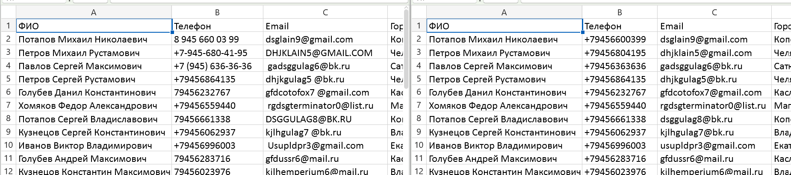

## Возможности
- Нормализация телефонов, email, ФИО, городов
- Очистка от пустых и бесполезных строк
- Удаление лишних пробелов
- Удаление дубликатов
- Отчёт: сколько было, что удалено, сколько осталось
## Пример работы


Результат: 100 строк → 93 после очистки.



##Автор

tg:@LiaAsami 

```bash
python -m src.pipeline -i examples/people.xlsx


